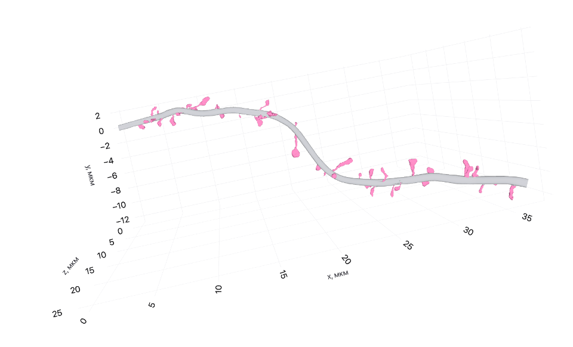
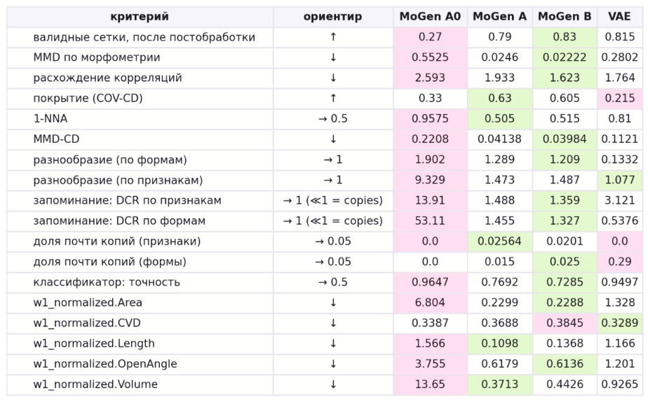
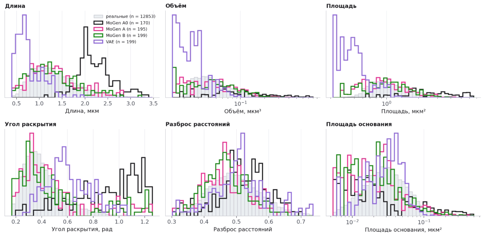
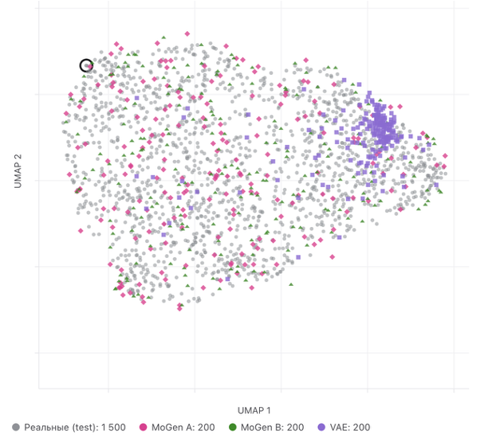
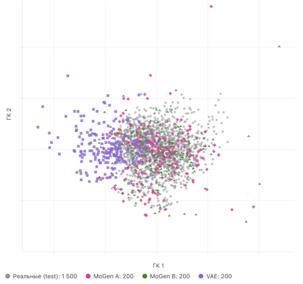

# Отчёт за 19.10–25.10

**Проект:** «Цифровой двойник нейрона»
**Команда:** 7

---

## Цели спринта

- Пилотный прогон предобработки ветвей на реальных данных, аудит обратной реконструкции и решение о форме поперечного сечения ствола.
- Обучение моделей T0 и P0 на реальных данных и проверка их по функционалам ветви.
- Реализация сборки ветви из ствола, положений шипиков и сеток шипиков, получение ветвей, у которых всё порождено моделями, и оценка собранных ветвей.
- Сравнение моделей генерации шипиков общей процедурой оценки и выбор модели.
- Подключение данных LabID (конфокальная микроскопия, здоровые, больные и леченные животные) и проект условной генерации шипиков.

---

## Этап 1. Пилотный прогон предобработки ветвей

Предобработка ветвей запущена на десяти нейронах Minnie65, для которых уже готова предобработка шипиков. Из 2396 объединённых ветвей 1779 получили статус «обработана», 272 оказались короче 2 мкм, а для 345 не удалось построить центральную линию. Почти все ветви последней группы (323 из 345) имеют длину 2–5 мкм: на таких ветвях помещается шесть–семь сечений, из которых достоверными остаются в среднем два, при минимально необходимых пяти. 

Первые результаты показали, что пороги контроля качества, выбранные по двум проверочным ветвям, для реальной выборки не подходят. Так, на тонких ветвях (радиус около 100–150 нм) вершины сетки разрежены, поэтому порог излома, заданный долей радиуса, срабатывал на обычных колебаниях центров сечений. Во все пороги, привязанные к радиусу, добавлены абсолютные нижние границы (например, излом фиксируется только при отклонении больше 150 нм). 

### Тонкие ветви и адаптивное сглаживание

Визуальная проверка на трёхмерных изображениях ветвей и сравнение с независимой методикой показали, что разброс центров сечений тонких ветвей (70–140 нм) является не только шумом измерения. В качестве независимой методики использовалась скелетизация сетки ветви методом потока средней кривизны из библиотеки CGAL. После одинакового сглаживания две линии расходятся в медиане лишь на 25–60 нм, то есть обе методики восстанавливают одну и ту же ось. Однако линия, сглаженная с шириной ядра 1 мкм, лежит внутри сетки тонкой ветви лишь в 30 % точек, тогда как сами центры сечений лежат внутри в 100 % случаев. Тонкий дендрит реально извивается на масштабах меньше микрометра, и сглаживание шириной 1 мкм эти извивы срезает. 

Поскольку тонкие ветви нужны для условной генерации (толщина ветви связана с типом клетки и компартментом), введено адаптивное сглаживание: ширина ядра пропорциональна медианному радиусу ветви, $h=\operatorname{clip}(k\,r_{\mathrm{med}},\,250,\,1000)$ нм, а шаг узлов равен половине $h$ (от 250 до 500 нм). Коэффициент $k$ выбран по исследованию на 120 ветвях из трёх классов радиуса, в котором сравнивались семь вариантов. Для $k=2$ результаты приведены в таблице.

| Класс радиуса | Доля линии внутри сетки, $h=1$ мкм | То же, $k=2$ | Ошибка круглой трубки / $r$, $h=1$ мкм | То же, $k=2$ |
| --- | ---: | ---: | ---: | ---: |
| $r<150$ нм | 0,32 | 0,84 | 0,48 | 0,28 |
| 150–250 нм | 0,58 | 0,91 | 0,42 | 0,29 |
| $r\ge250$ нм | 0,96 | 1,00 | 0,26 | 0,21 |

Значения $k=3$ и $k=4$ дали худший результат на тонких и средних ветвях. У адаптивного сглаживания обнаружилось побочное следствие. Проверка рамки ограничивала её кручение абсолютным порогом $10^{-5}$ нм⁻¹, а у рамки, построенной методом двойного отражения, остаётся дискретное кручение порядка $0{,}05\,\kappa^2\Delta s$. С ростом кривизны тонких ветвей 301 ветвь из 1779 стала ложно не проходить проверку, поэтому порог сделан относительным (одна десятая максимальной кривизны ветви). 

### Форма сечения: аудит обратной реконструкции

После адаптивного сглаживания аудит обратной реконструкции выполнен на ста ветвях. Круглое сечение критерию приёмки ($\sqrt{CD/2}\le0{,}25\,r$) по-прежнему не удовлетворяет: медиана составляет 123 нм, или 0,67 радиуса, критерий выполнен лишь у 4 % ветвей, а площадь трубки отличается от площади ствола на 18 %. Поскольку линия теперь лежит внутри ствола, первой гипотезой была некруглая форма сечений: расстояние от оси до ближайшей стенки у обеих методик составляет 0,55–0,63 радиуса, то есть сечения сплюснуты. Поэтому в предобработку добавлена подгонка эллипса к каждому сечению (прямой метод Фитцгиббона в численно устойчивой форме Халира — Флуссера, с отбрасыванием выбросов по невязке эллипса) и профили полуосей $a(s)$, $b(s)$ и угла большой оси в рамке ветви.

Эллипс подогнался у всех сечений, медиана отношения полуосей $b/a$ составила 0,72, то есть сечения действительно заметно сплюснуты. Но ошибка реконструкции от этого почти не уменьшилась. Чтобы понять почему, ошибка была разложена на части. Точки поверхности, удалённые от линии больше чем на 1,75 радиуса, занимают 22 % площади ствола, и на них приходится основная доля ошибки. Это выросты, не отделённые сегментацией. Кроме того, двусторонняя мера штрафует трубку и над отверстиями, оставшимися после удаления настоящих шипиков. На «ядре» ствола (ближе 1,75 радиуса от линии) эллипс уменьшает ошибку лишь на 5 % (медиана 0,27 → 0,25 радиуса). Выводы: 
- критерий приёмки по всей поверхности для гладкого ствола без выростов недостижим в принципе, и его следует вычислять по ядру,
- профиль эллипса сохраняется в данных, но первая версия модуля T обучается на круглом сечении, тк при генерации эллипс даёт малый выигрыш при трёх дополнительных каналах.

### Положения шипиков

Проверка распределения положений шипиков выявила систематический сдвиг. Центр основания шипика лежит не на поверхности ствола, а снаружи: у ветвей радиусом от 200 нм медиана превышения составляет +137 нм (0,44 радиуса), девяностый процентиль — 1,29 радиуса, и учёт эллиптичности сечения картину не меняет. Срез, отделяющий шипик от ствола, проходит по шейке чуть выше поверхности ствола. Прежнее симметричное правило отбраковки ($|d|>0{,}75\,r$) отбрасывало 25 % положений, причём неслучайно: терялись шипики с длинным остатком шейки. Правило сделано несимметричным (выброс, если основание глубже половины радиуса внутри ствола или дальше $\max(2r,\,400\text{ нм})$ снаружи). Доля шипиков без положения снизилась до 7 %, число ветвей, пригодных для P, выросло с 1030 до 1305.

---

## Этап 2. Модели T0 и P0 на реальных данных

Для пробного обучения построен временный сплит по нейронам пилотного прогона (восемь обучающих, один валидационный и один тестовый). Окончательный сплит строится после завершения предобработки шипиков, поэтому все численные результаты этого этапа предварительны.

**Модель числа и положений шипиков.** По правдоподобию на валидации выбрана модель с нулевым избытком на основе отрицательного биномиального распределения, площадью ствола в качестве экспозиции и случайным эффектом нейрона. Модель положений с признаками вдоль ветви не превосходит равномерного распределения, то есть при данном объёме данных положение шипиков вдоль ветви от рассмотренных признаков не зависит.

**Извилистость ствола в модели T0.** Сгенерированные стволы оказались значительно извилистее реальных, причём разрыв рос с длиной ветви. Отбраковка маскировала дефект: принималось лишь 36 % образцов, то есть случайно прямые стволы, и распределение принятых было смещено. Причина в структуре модели. Процесс Орнштейна — Уленбека на изгибе имеет память около микрометра, а направление ствола есть накопленная сумма поворотов, поэтому оно ничем не удерживается и совершает свободное случайное блуждание. Реальные же дендриты сохраняют общее направление. Изгиб в T0 заменён моделью наклона касательной к оси ветви второго порядка: скорость поворота — гладкий процесс Орнштейна — Уленбека, а сам наклон возвращается к оси с характерной длиной $L_d$. Длина $L_d$ выбирается по профилю правдоподобия, и при $L_d\to\infty$ модель совпадает с прежней. Изгиб $(\kappa_1,\kappa_2)$ вычисляется из сгенерированных касательных операцией, точно обратной восстановлению геометрии, поэтому остальной модуль и сборка не меняются.

Первая версия новой модели с общей для всех ветвей амплитудой поворота убрала рост извилистости с длиной, но изгиб остался в 2,7 раза больше реального. Оказалось, что ветви сильно различаются по изогнутости, и общая амплитуда, оценённая по всем узлам сразу, определяется самыми изогнутыми из них. Поэтому амплитуда сделана случайным эффектом ветви. Её логарифм нормален со средним, зависящим от радиуса ветви и группы. Дисперсия каждой ветви исключается из правдоподобия в замкнутой форме, а разброс между ветвями оценивается за вычетом шума оценки. Модель выбрала $L_d=3$ мкм и длину памяти поворота 3,4 мкм. Амплитуда поворота убывает с радиусом как $r^{-1{,}87}$, разброс между ветвями составляет 1,86 раза, а сдвиги групп близки к нулю: при учёте радиуса изогнутость от компартмента почти не зависит. Последовательные результаты приведены в таблице (медианы, для извилистости — без отбраковки).

| Показатель | Реальные ветви | Изгиб — процесс О.—У. | Возврат к оси, общая амплитуда | Возврат к оси, амплитуда ветви |
| --- | ---: | ---: | ---: | ---: |
| Извилистость, ветви короче 20 мкм | 1,02 | 1,21 | 1,16 | 1,02 |
| Извилистость, 20–50 мкм | 1,04 | 2,13 | 1,23 | 1,09 |
| Извилистость, от 50 мкм | 1,09 | 2,71 | 1,31 | 1,15 |
| Среднеквадратичный изгиб, мкм⁻¹ | 0,15 | 0,24 | 0,40 | 0,16 |
| Автокорреляция изгиба на 1 мкм | 0,51 | 0,58 | 0,17 | 0,43 |
| Доля принятых образцов | — | 0,36 | 0,95 | 0,97 |
| Среднее $W_1/\sigma$ по шести функционалам | — | 1,48 | 1,56 | 0,52 |

Шумовой пол сравнения составляет 0,31. Остаются два расхождения: верхний хвост извилистости (девяностый процентиль 1,37 против 1,10) и профиль радиуса (средний радиус 323 против 366 нм).

### Разброс радиуса вдоль ветви

Одно из двух остающихся расхождений T0 – слишком ровный профиль радиуса: коэффициент вариации радиуса вдоль сгенерированной ветви 0,07 против 0,12 у реальной. Остаток логарифма радиуса относительно среднего профиля был описан процессом с одной стационарной дисперсией на группу. Такая дисперсия, оценённая по всем узлам сразу, задаётся длинными ветвями, и все сгенерированные ветви получают одинаковую типичную амплитуду колебаний. Поэтому амплитуда остатка была сделана случайным эффектом ветви по той же схеме, что и амплитуда поворота: её логарифм нормален со средним, зависящим от радиуса и длины ветви, а разброс между ветвями оценивается за вычетом шума оценки. На синтетических данных с известной структурой метод восстанавливает заложенные параметры и воспроизводит разброс коэффициента вариации между ветвями.

На реальных данных коэффициент вариации почти не изменился: на валидации 0,082 против 0,114 у реальных ветвей, среднее $W_1/\sigma$ по шести функционалам 0,48 при шумовом уровне 0,31. То же сравнение было выполнено на 500 обучающих ветвях. Результат отрицательный для модели: на данных, по которым она подбиралась, коэффициент вариации также занижен (0,080 против 0,118 при радиусе до 300 нм, 0,079 против 0,096 при 300–500 нм, 0,044 против 0,060 от 500 нм). Следовательно, причина в структуре модели, а не в выборке.

Оценённые параметры показывают, что именно остаётся неописанным. Длина памяти остатка составила 54,5 мкм, то есть остаток превратился в почти постоянный сдвиг уровня вдоль ветви и не даёт колебаний на масштабе ветви. Его амплитуда слабо растёт с радиусом (степень $+0{,}26$), тогда как в данных относительная изменчивость убывает с радиусом (коэффициент вариации 0,12 у ветвей тоньше 300 нм и 0,05 у ветвей от 500 нм). 

---

## Этап 3. Сборка ветви

Сборка реализована следющим образом: центральная линия уплотняется до шага 100 нм (сечение круглое), для каждого положения шипика вычисляются опорная точка на поверхности и рамка (ось роста шипика совмещается с нормалью к стволу, его продольная ось — с касательной ствола). Основанием шипика считаются вершины не выше 30 нм над центром крепления. Шипик погружается вдоль нормали на наименьшую глубину, при которой основание целиком оказывается внутри ствола с запасом 10 нм. Эта функция глубины немонотонна: если погрузить основание глубже радиуса ствола, оно выходит с противоположной стороны. Поэтому глубина ищется по сетке в пределах радиуса с уточнением бисекцией. Шипик отвергается и заменяется другим, если основание шире ствола, если тело шипика проникает в ствол или если шипик пересекается с уже поставленным. Затем ствол и все шипики объединяются одной булевой операцией библиотеки Manifold: погружённые основания оказываются внутри общего объёма и исчезают, и явного сшивания граничных петель не требуется.

После булева объединения в сетке могут остаться вырожденные треугольники нулевой площади: операция оставляет их там, где поверхности почти касаются. Большая часть таких треугольников устраняется стягиванием рёбер короче заданного допуска (от 0,1 до 5 нм), что не меняет геометрию при длине рёбер сетки 10–50 нм. Однако встречается и треугольник другого типа: все его стороны длинные, но одна вершина лежит на противоположной стороне. Стягивание коротких рёбер такой треугольник не затрагивает, и он устраняется перебросом ребра, то есть заменой двух соседних треугольников, разделённых длинной стороной, на пару треугольников по другой диагонали.

### Сравнение собранных ветвей с реальными

Для количественной оценки каждая сгенерированная ветвь сопоставляется с реальной ветвью, из которой был взят её запрос, то есть с ветвью тех же условий и длины. Поэтому различия в составе условий не смешиваются с ошибками моделей. Сравниваются число шипиков и их плотность на единицу длины, доля ветвей без шипиков (в целом и по классам длины), функционалы ствола, положения шипиков вдоль ветви, расстояние до ближайшего соседа по поверхности ствола, интервалы между соседними шипиками и распределение угла вокруг ствола. Масштаб различий задаёт шумовой пол — то же сравнение двух половин реальной выборки.

### Ветви с шипиками, порождёнными моделью MoGen

Получены ветви, полностью созданные моделями: форму ствола задаёт модель T0, число и положения шипиков — модель P0, форму каждого шипика — модель MoGen, дообученная на наших данных. Условия генерации (тип клетки, компартмент, длина, концевая ветвь, расстояние до сомы) взяты у 20 проверочных ветвей, поэтому каждой собранной ветви соответствует реальная ветвь тех же условий. Набор сеток шипиков состоит из 200 образцов MoGen A. Из них 186 пригодны для сборки (замкнуты, имеют положительный объём и найденное основание), 14 отбракованы: девять не замкнуты, у пяти не найдено основание. В сборке использовано 141 сетка.

Собрано 20 ветвей, 18 из них (90 %) представляют собой одну замкнутую поверхность, 15 не имеют замечаний. Из 387 запрошенных шипиков поставлено 384. Медианная глубина погружения основания в ствол составила 62 нм, медианное время сборки одной ветви 0,8 с. У пяти ветвей остались замечания: у трёх вырожденные треугольники, у двух несколько компонент; причину в последнем случае ещё предстоит выяснить (ниже).

Сравнение с реальными ветвями тех же условий показывает следующее. Положения шипиков вдоль ветви и их угловое распределение воспроизведены на уровне шумового пола, расстояние до ближайшего соседа близко к реальному (медианы 854 и 791 нм). Плотность шипиков занижена примерно вдвое: 0,52 против 1,00 на микрометр; по классам длины 0,22 против 0,70 (до 20 мкм), 0,45 против 1,13 (20–50 мкм) и 0,65 против 1,03 (от 50 мкм). Разброс радиуса вдоль ветви меньше реального (коэффициент вариации 0,074 против 0,126). Форма шипика пока не зависит от условий ветви: шипик выбирается из набора случайно. Результаты собраны в интерактивном отчёте branch_report.html (описание в разделе «Приложенные материалы»), пример собранной ветви показан на рисунке 1.

*Рис 1. Собранная ветвь дендрита.Ствол сгенерирован моделью T0, число и положения шипиков моделью P0, форма шипиков дообученной моделью MoGen.*

### Выбор шипика по радиусу ствола

Из 20 собранных ветвей в проверке со случайным выбором шипика основной причиной неудачных попыток постановки было то, что основание выбранного шипика шире ствола в точке крепления. Это естественно: размер основания у реальных шипиков связан с радиусом ствола, а случайный выбор эту связь игнорирует. По 11 027 реальным шипикам пилотных нейронов подобрана зависимость логарифма эквивалентного радиуса основания $b=\sqrt{S/\pi}$ (по площади петли крепления) от радиуса ствола $r$ в точке крепления: $\log b = 4{,}707 + 0{,}320\,\log(r/300\text{ нм}) \pm 0{,}341$. Связь существует, но слабая: коэффициент корреляции 0,22. При сборке шипик из набора выбирается с вероятностью, пропорциональной значению этой зависимости для радиуса ствола в месте постановки, с поправкой на то, как размеры основания распределены в самом наборе; таким образом, выбор воспроизводит реальное условное распределение, а не размеры, преобладающие в наборе.

Проверка на новом наборе из 50 сгенерированных ветвей (по 20 собранных каждым способом, одно случайное зерно, шипики одного и того же набора MoGen A) дала следующее.

| Показатель | Случайный выбор | Выбор по радиусу ствола |
| --- | ---: | ---: |
| Ветвей, замкнутых и состоящих из одной компоненты | 19 из 20 | 17 из 20 |
| Поставлено шипиков из 366 запрошенных | 364 | 364 |
| Неудачные попытки: основание шире ствола | 72 | 28 |
| Неудачные попытки: столкновение шипиков | 22 | 28 |
| Медианная глубина погружения основания, нм | 55 | 59 |

Выбор по радиусу в 2,6 раза сократил число попыток, в которых основание не помещается, но не изменил число поставленных шипиков, потому что такие попытки и раньше исправлялись повторным выбором. Число ветвей из нескольких компонент выросло с одной до трёх, однако различие 1 против 3 из 20 статистически не значимо. Шипики в этих трёх ветвях не отличаются от остальных ни размером основания, ни глубиной погружения, ни числом попыток; все три ветви густые (23–32 шипика при медиане 12), но среди густых есть и ветви без замечаний, и ветвь с замечанием в сборке со случайным выбором. Причина отделения компоненты по таблице шипиков не определяется, поэтому в сборку добавлена диагностика, которая для каждой отделившейся компоненты записывает размер и ближайший шипик. Выбор по радиусу пока остаётся необязательным режимом.

Оценка собранных ветвей на этом наборе показывает, что положения шипиков вдоль ветви ($W_1/\sigma=0{,}06$ при шумовом уровне 0,13) и их углы совпадают с реальными, плотность занижена (0,33 против 1,00 на микрометр). Меньшее значение плотности, чем в предыдущем наборе (0,52), вероятно, связано с розыгрышем случайного эффекта нейрона для каждой ветви. Сам разрыв не зависит от способа выбора шипика и относится к модели числа шипиков, которая в этом спринте не менялась.

---

## Этап 4. Сравнение моделей генерации шипиков

### Данные и модели

В первой версии генерация безусловна: сначала проверяется, способна ли модель воспроизвести распределение форм, и лишь затем вводятся условия. Данные взяты из предобработки шипиков Minnie65 и разбиты по нейронам на 80 обучающих, 10 проверочных и 10 тестовых. Шипики приведены к единой системе координат с началом в центре основания, случайные повороты не использовались, размер шипика сохранён.

Сравнивались три модели и базовая линия. Модель A — MoGen (Flow Matching на облаках из 8192 точек), предобученная на нейронных структурах мыши и дообученная на наших шипиках. Модель B — та же архитектура, обученная с нуля. Модель C — вариационный автокодировщик (VAE), декодер которого выдаёт знаковое расстояние до поверхности. 

### Отладка вариационного автокодировщика

Обучение VAE потребовало наибольшей отладки, причём каждая проблема скрывала следующую. Сначала декодер не использовал латентный код: ошибка с кодом чужого шипика не отличалась от ошибки с собственным. Причинами были начальная дисперсия латента, неподходящая инициализация первого слоя декодера, штраф KL с первого шага (коллапс апостериора) и, главное, нормализация по каналам в энкодере, стиравшая различия между шипиками. Затем выяснилось, что декодер не обучен вне рамки своего шипика, из-за чего сетки распадались на тысячи фрагментов, поэтому были добавлены обучающие точки по общей рамке. Далее поле расстояния оказалось «рябым» (значения точны, градиент почти случаен): регуляризаторы (эйконал и согласование градиента с нормалью) — пришлось включить с первого шага, а выйти с плато помогло косинусное затухание скорости обучения. В итоге доля валидных сырых сеток выросла с 4 до 90 %, а медианное расстояние Чамфера снизилось с 255 до 31 нм.

### Протокол оценки

Все модели оцениваются одной процедурой на одних и тех же тестовых шипиках, причём сырые и постобработанные сетки оцениваются раздельно, чтобы модель, выглядящая хорошо только после серьёзного исправления, не получала преимущества. Измеряются: доля валидных сеток (замкнуты, одна компонента, положительный объём, нет самопересечений и вырожденных граней), совпадение распределений 11 морфометрических признаков (расстояние Васерштейна, нормированное на разброс реальных значений, $W_1/\sigma$, и статистика Колмогорова — Смирнова), тех же признаков совместно (максимальное среднее расхождение, MMD) и их корреляций, сходство форм по расстоянию Чамфера (покрытие реальных форм и 1-NNA — точность классификации реальных и сгенерированных форм по ближайшему соседу в объединённом наборе, где значение 0,5 означает неразличимость), разнообразие (отношение средних расстояний внутри наборов), запоминание (расстояние от сгенерированной формы до ближайшей обучающей в сравнении с тем же для реальных тестовых шипиков), классификатор, отличающий реальные шипики от сгенерированных по десяти морфометрическим признакам. Для сгенерированной сетки область крепления неизвестна и находится по геометрии, поэтому признаки, зависящие от основания, содержат небольшую систематическую ошибку, она оценена на 500 реальных шипиках и не приписывается модели. Оценка выполнена по 200 образцам на модель с одним зерном генератора, поэтому разницу в несколько процентов (особенно между A и B) нельзя считать значимой.

### Результаты

Сводка всех критериев показана на рисунке 2, распределения основных признаков — на рисунке 3.

*Рис 2. Сводка критериев для четырёх моделей: цвет ячейки показывает место модели по данному критерию.*

*Рис 3. Распределения основных морфометрических признаков реальных шипиков (тестовые нейроны) и шипиков, сгенерированных каждой моделью.*

Прежде всего, дообучение работает однозначно. Без него MoGen порождает формы, которые классификатор отличает от реальных в 96 % случаев, 1-NNA близок к единице, морфометрическое разнообразие в девять раз шире реального, а длина, площадь и объём отличаются на единицы и десятки стандартных отклонений. После дообучения эти отличия падают в десятки раз: MMD с 0,55 до 0,025, $W_1/\sigma$ по длине с 1,57 до 0,11, 1-NNA с 0,96 до 0,505. Далее, модели A и B практически неразличимы: по 1-NNA, покрытию и MMD по формам (0,041 и 0,040) они равны в пределах шума. Следовательно, дообучение достигает качества обучения с нуля при примерно четверти времени.

Вариационный автокодировщик выигрывает в топологии и проигрывает в распределении. Он даёт 80 % валидных сырых сеток против 50 % у MoGen, у каждой сетки род нулевой, и постобработка ничего не меняет. Но его распределение формы далеко от реального: классификатор отличает 95 % его шипиков, 1-NNA равен 0,81, покрытие 0,21, то есть лишь пятая часть реальных форм оказывается ближайшей к какой-либо сгенерированной. Разнообразие мало (отношение 0,13 против 1,2–1,3 у MoGen). Проверка запоминания у VAE неоднозначна: по Чамферу сгенерированные формы ближе к обучающим, чем тестовые (0,54), а по морфометрии дальше (3,1). Расхождение мер говорит скорее об усреднённых типичных формах, чем о копиях, но это предположение. У MoGen оба показателя больше единицы, доля почти-копий 1,5–3 % (ориентир 5 %): копирования нет.

### Проверка гипотезы о приоре VAE

Выдвинута гипотеза: Низкое разнообразие VAE связано с выборкой из стандартного нормального распределения. Вес штрафа KL выбран очень малым ($10^{-4}$), чтобы декодер продолжал использовать код, из-за этого коды реальных шипиков занимают узкую область латентного пространства, а стандартный шум попадает мимо неё, и декодер выдаёт усреднённые формы. Для проверки к кодам 2000 обучающих шипиков подогнано нормальное распределение, и из него сгенерировано 200 шипиков.

| Критерий (после постобработки) | VAE, стандартный приор | VAE, коды реальных шипиков | MoGen A | MoGen B |
| --- | ---: | ---: | ---: | ---: |
| MMD по морфометрии (ниже лучше) | 0,28 | 0,12 | 0,025 | 0,022 |
| Покрытие | 0,215 | 0,475 | 0,63 | 0,605 |
| 1-NNA (к 0,5) | 0,81 | 0,645 | 0,505 | 0,515 |
| Разнообразие по форме (к 1) | 0,13 | 0,60 | 1,29 | 1,21 |
| Классификатор (к 0,5) | 0,95 | 0,95 | 0,77 | 0,73 |
| $W_1/\sigma$, длина | 1,17 | 0,71 | 0,11 | 0,14 |

Гипотеза подтвердилась частично. Покрытие выросло с 0,21 до 0,48, разнообразие с 0,13 до 0,60, MMD по признакам снизился более чем вдвое, то есть примерно половина разрыва с MoGen объясняется приором. Оставшаяся половина не объясняется: классификатор по-прежнему отличает 95 % шипиков, а расхождение по длине и площади остаётся около одного стандартного отклонения.

### Выбор модели

Для следующего шага (условная генерация и сборка ветвей) выбрана модель A. Она достигает качества B при четверти времени обучения, не копирует обучающие шипики и лучше VAE по всем критериям распределения формы. VAE остаётся эталоном по топологии и источником латентного пространства для анализа. Обучать его дольше нет смысла: реконструкция у него уже хорошая, а узкое место — выборка новых шипиков. Ограничения оценки: одно зерно и 200 образцов на модель без доверительных интервалов, оценка на разбиении из 100 нейронов, объяснения про усреднённые формы VAE — гипотезы. Для итоговых чисел запланирована оценка 1000 образцов с пятью зёрнами.

Все сравнения собраны в интерактивном атласе spine_report.html (описание в разделе «Приложенные материалы»). Два его фрагмента показаны на рисунках 4 и 5.

*Рис. 4. Реальные шипики тестовых нейронов и сгенерированные шипики всех моделей в латентном пространстве VAE (UMAP)*

*Рис. 5. Реальные шипики тестовых нейронов и сгенерированные шипики всех моделей в пространстве морфологических признаков (PCA)*

---

## Этап 5. Данные LabID

К данным добавлен набор LabID: 179 фрагментов дендритов мыши в пяти группах. Группы Wt (37 фрагментов) и Wt_old (47) — здоровые животные двух серий съёмки, Ab (24) — модель болезни, Ab+9009 (35) и Wt+9009 (36) — животные, получавшие вещество 9009 (после болезни и здоровые соответственно). Для каждого фрагмента есть сетка ствола с шипиками, сетка ствола без шипиков и запанные сетки шипиков. Принято, что каждая папка набора — отдельная ветвь.

Главное отличие LabID — способ съёмки. Minnie65 и H01 получены электронной микроскопией, LabID — конфокальной (световой), и данные заметно отличаются по масштабу. По длине фрагменты LabID сопоставимы с типичными ветвями Minnie65 (медианы около 24 и 18 мкм), но не превышают 70 мкм, тогда как у десятой части ветвей Minnie65 длина больше 100 мкм. Длина фрагмента определяется размером кадра, то есть концы фрагментов — это границы кадра, а не точки ветвления, поэтому длину фрагмента LabID нельзя считать свойством ветви. Радиус ствола в LabID составляет в среднем около 0,6 мкм против 0,3–0,4 мкм у дендритов Minnie65, плотность шипиков около 0,3 на микрометр против примерно одного у проверочных ветвей Minnie65. Размеры шипиков сопоставимы по длине, но площадь поверхности в 2,7 раза больше (4,1 против 1,5 мкм²). Такое различие похоже на сглаживающее действие светового микроскопа, которое утолщает тонкие структуры. Размер вокселя в файлах изображений не записан, по габаритам сетки он оценён в 22 нм в плоскости и около 97 нм по оси $z$, это предстоит подтвердить в лаборатории.

---

## Этап 6. Проект условной генерации шипиков

Для условной генерации выбрана модель A: в ней уже есть вход для условий, в который при безусловной генерации подаются нули. Разработана схема условного обучения: условия кодируются блоками (вид, источник данных, тип микроскопии, состояние, лечение веществом 9009, тип клетки, компартмент, позднее радиус ствола), а блок из нулей означает «неизвестно», что позволяет задавать условия частично. При обучении часть блоков случайно обнуляется, поэтому одна модель умеет порождать шипики и при частично известных условиях, и безусловно. Для проверки условности предусмотрены оценка того, различаются ли реальные шипики при разных значениях условия, сопоставление сгенерированных шипиков с реальными при каждом значении и проверка, определяет ли классификатор по морфометрии заданное условие. Первое обучение запланировано на данных Minnie65 (тип клетки, компартмент).

---

## Приложенные материалы

**branch_report.html** — отчёт о 20 ветвях, полностью созданных моделями: трёхмерные ветви с реальной ветвью тех же условий для сравнения и статистика набора (плотность шипиков, положения, углы, причины неудач при постановке).

**spine_report.html** — файл сравнения моделей A, B и VAE на 1500 реальных тестовых шипиках: карты форм, распределения признаков, галерея шипиков, качество поверхности и латентные направления. 

---

## Результаты спринта

- Выполнен пилотный прогон предобработки ветвей на десяти нейронах. 

- Доработана модель T0: направление ствола возвращается к оси ветви, амплитуда поворота — случайный эффект ветви. 

- Реализована сборка ветви булевым объединением. Сгенерирован первый набор полностью смоделированных ветвей.

- Проведено сравнение трех моделей генерации шипиков (MoGen с дообучением, MoGen с нуля, VAE). Для условной генерации выбрана модель MoGen с дообучением.

- Подключён набор LabID (конфокальная микроскопия). Разработан способ определения области крепления по запаянным шипикам, выполнены предобработка шипиков и ветвей: из 179 ветвей обработано 159, пригодны для T 22, для P 58. Выявлены систематические отличия масштаба и растяжение по оси $z$.

- Разработана схема условной генерации шипиков: блочный вектор условий (вид, источник данных, тип микроскопии, состояние, лечение, тип клетки, компартмент), обучение с пропуском условий и схема проверки условности.

---

## Планы

1) Запустить полную предобработку ветвей Minnie65,  переобучить T0 и P0 на полной выборке и повторить оценку собранных ветвей.

2) Выяснить причину заниженной плотности шипиков (сравнить среднее и медиану случайного эффекта нейрона, режим с реальным стволом, влияние минимального расстояния между шипиками).

3) Выяснить причину отделения компонент у части собранных ветвей по новой диагностике и решить, делать ли выбор шипика по радиусу режимом по умолчанию.

4) Реализовать условную генерацию шипиков на модели A: кодировщик условий, обучение с пропуском условий на данных Minnie65, проверка условности.
