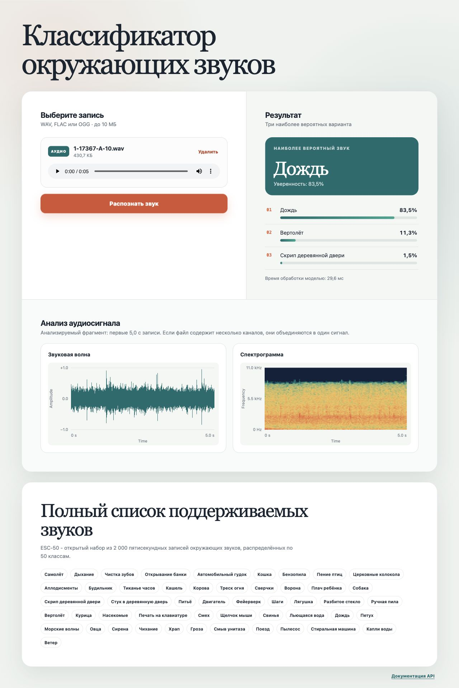

# Отчёт за 26.10–01.11

**Проект:** «Распознавание окружающих звуков»  
**Команда:** 8

## 1. Цель работы за отчётный период

Завершить основной пользовательский интерфейс приложения: добавить график
звукового сигнала и спектрограмму выбранной записи, сделать вероятности трёх
классов более наглядными, показать полный каталог поддерживаемых звуков и
проверить удобство работы на мобильной ширине экрана.

## 2. Что было сделано

### 2.1. Визуализация звукового сигнала

- После выбора файла браузер декодирует запись с помощью Web Audio API и строит
  графики без дополнительного запроса к серверу.
- Для согласованности с моделью визуализируются первые пять секунд записи.
- Многоканальный звук приводится к одному каналу и нормализуется по пиковой
  амплитуде так же, как в серверном конвейере подготовки аудио.
- График временной формы показывает минимальную и максимальную амплитуду для
  каждого горизонтального пикселя. Благодаря этому на уменьшенном графике не
  теряются короткие пики сигнала.
- На график добавлены подписи амплитуды и времени. Canvas учитывает плотность
  пикселей экрана, поэтому линии остаются чёткими на дисплеях HiDPI.

### 2.2. Спектрограмма

- В браузерной части реализовано оконное преобразование Фурье без внешнего
  сервиса и дополнительных JavaScript-зависимостей.
- Запись разбивается на 128 временных кадров; для каждого кадра применяется окно
  Ханна и быстрое преобразование Фурье размером 1024 отсчёта.
- Энергия объединяется в 96 частотных полос и переводится в относительную шкалу
  децибел с динамическим диапазоном 80 дБ.
- Цветовая шкала от тёмно-синего к оранжевому показывает увеличение энергии.
  Добавлены подписи времени и частоты.
- Ошибка браузерного декодирования не блокирует распознавание: пользователь
  получает пояснение и по-прежнему может отправить файл серверной модели.

### 2.3. Наглядное представление результата

- Для каждого из трёх предсказаний добавлена горизонтальная полоса, длина которой
  соответствует уверенности модели.
- Полосы снабжены атрибутами `progressbar`, поэтому значения доступны не только
  визуально, но и программам экранного доступа.
- Основной класс, числовые проценты и время обработки сохранены, поэтому графика
  не заменяет точные значения.

### 2.4. Каталог классов и описание ESC-50

- В панели каталога поясняется, что ESC-50 содержит 2 000 пятисекундных записей
  окружающих звуков, распределённых по 50 классам.
- Полный список классов загружается из `GET /classes`, отображается сразу и не
  требует отдельного раскрытия.
- Для всех идентификаторов показаны русские названия. Таким образом, каталог в
  интерфейсе соответствует реально загруженному модельному артефакту.
- Каталог оформлен отдельной белой панелью, визуально согласованной с основной
  рабочей областью приложения.

### 2.5. Адаптивность, тесты и документация

- На узком экране панели загрузки и результата, оба графика и каталог классов
  перестраиваются в одну колонку.
- Главный экран упрощён: название проекта стало основным заголовком, а отдельный
  вводный абзац и индикатор состояния модели удалены как необязательные
  визуальные элементы.
- Декоративная нумерация разделов загрузки, результата и анализа аудиосигнала
  удалена.
- Над графиками оставлены только их названия; дополнительные поясняющие строки
  удалены для уменьшения визуальной нагрузки.
- Раздел визуализаций получил название «Анализ аудиосигнала», а подписи осей
  `Amplitude`, `Frequency` и `Time` приведены к академической записи на английском
  языке. Шкала амплитуды явно показывает диапазон от −1,0 до +1,0.
- Canvas автоматически перерисовываются при изменении ширины, но преобразование
  Фурье повторно не вычисляется.
- Исправлено поведение HTML-атрибута `hidden` для flex- и grid-компонентов: после
  смены состояния на странице остаётся только актуальное содержимое.
- Тест веб-страницы дополнен проверкой обоих canvas, каталога классов и
  индикаторов вероятности.
- Все 20 автоматических тестов проходят; Ruff не обнаруживает ошибок, проверка
  форматирования также проходит.
- README обновлён описанием визуализаций, полного сценария работы и адаптивного
  интерфейса.

## 3. Полученные результаты

### 3.1. Сквозная проверка приложения

Для проверки использована запись дождя `1-17367-A-10.wav` из ESC-50.

| Шаг | Ожидаемый результат | Результат проверки |
|---:|---|---|
| 1 | Открытие приложения | Страница загружена, отображён каталог 50 классов |
| 2 | Выбор WAV-файла | Показаны имя, размер и аудиоплеер |
| 3 | Построение визуализаций | Отображены волна и спектрограмма первых 5,0 с |
| 4 | Отправка в `POST /predict` | Запрос успешно обработан |
| 5 | Представление результата | Показаны основной класс, top-3, проценты и полосы уверенности |

Модель вернула те же классы и значения, что и в предыдущих сквозных проверках:

| Место | Класс | Уверенность |
|---:|---|---:|
| 1 | `rain` | 0,8350 |
| 2 | `helicopter` | 0,1126 |
| 3 | `door_wood_creaks` | 0,0152 |

Правильный класс `rain` занял первое место. При повторном запросе после прогрева
обработка моделью заняла 29,6 мс.

### 3.2. Проверка мобильного отображения

Интерфейс проверен при ширине viewport 390 пикселей. Горизонтальная прокрутка не
появилась: ширина документа осталась равна 390 пикселям. Панели загрузки и
результата, оба графика, описание ESC-50 и каталог классов корректно выстроились
в одну колонку; длинное имя файла и название класса не вышли за границы
компонентов.

### 3.3. Итог этапа

Выполнена контрольная точка на 2 ноября: приложение предоставляет законченный
сценарий от выбора и прослушивания файла до распознавания, а также наглядно
показывает сам сигнал, его частотный состав и соотношение уверенностей модели.
Интерфейс пригоден для использования на настольном и мобильном экране.

## 4. Возникшие проблемы и принятые решения

- Подключение внешней библиотеки графиков увеличило бы число зависимостей и могло
  потребовать доступ к CDN. Визуализации реализованы средствами Web Audio API и
  Canvas, поэтому приложение по-прежнему полностью работает локально.
- Полное преобразование каждой точки длинной записи в браузере было бы слишком
  затратным. Спектрограмма ограничена теми же пятью секундами, которые использует
  модель, и фиксированной сеткой из 128 кадров и 96 частотных полос.
- Размер bitmap у canvas не меняется автоматически вместе с CSS-размером.
  Добавлено наблюдение за изменением ширины и перерисовка из уже рассчитанных
  данных с учётом плотности пикселей экрана.
- Стили `display: flex` и `display: grid` переопределяли стандартное скрытие
  некоторых элементов. Добавлено общее правило для атрибута `hidden`, после чего
  повторно проверены выбор файла, результат и визуализации.
- Поддержка аудиокодеков браузером и сервером может различаться. Невозможность
  построить локальные графики обрабатывается отдельно и не запрещает отправку
  записи серверу, где контейнер проверяет SoundFile.

## 5. Созданные файлы и ссылки

- Репозиторий проекта: [sound-recognition](https://github.com/djentdjentdjent/sound-recognition)
- Разметка визуализаций и справки: [`index.html`](https://github.com/djentdjentdjent/sound-recognition/blob/main/src/sound_recognition/templates/index.html)
- Построение волны, спектрограммы и полос вероятности: [`app.js`](https://github.com/djentdjentdjent/sound-recognition/blob/main/src/sound_recognition/static/app.js)
- Адаптивное оформление: [`styles.css`](https://github.com/djentdjentdjent/sound-recognition/blob/main/src/sound_recognition/static/styles.css)
- Проверка элементов страницы: [`test_api.py`](https://github.com/djentdjentdjent/sound-recognition/blob/main/tests/test_api.py)
- Инструкция запуска и описание интерфейса: [`README.md`](https://github.com/djentdjentdjent/sound-recognition/blob/main/README.md)

## 6. План на следующую неделю

- Проверить тихие, зашумлённые и нестандартные по длительности записи.
- Проверить слишком большие файлы и звуки, классы которых отсутствуют в ESC-50.
- Дополнить автоматические тесты обработки аудио, модели и API.
- Проверить повторные запросы, удаление и замену выбранного файла.
- Исправить обнаруженные ошибки интерфейса и серверной части.
- Измерить время обработки серии записей и подтвердить стабильность локального
  запуска перед контейнеризацией.
