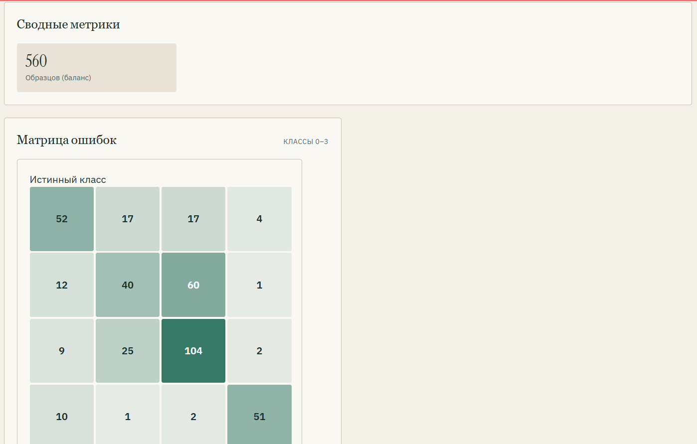

# Отчёт за 16.11–22.11

### **1. Изменена структуризация и внешний вид страницы с предварительными результатами**

- Переработана структура страницы для более удобного и последовательного отображения промежуточных результатов анализа.
- Систематизированы информационные блоки с метриками модели, графиками, матрицей ошибок и визуализациями данных.
- Повышена наглядность представления результатов и удобство их интерпретации.

### **2. Произведён рефакторинг модели**

- Переработана структура программного кода модели с целью повышения читаемости и упрощения дальнейшего сопровождения.
- Упорядочены процессы загрузки обученных весов, инициализации архитектуры и выполнения предсказаний.
- Улучшено разделение логики обработки входных данных, вычисления эмбеддингов и классификации.
- Подготовлена более структурированная основа для дальнейшего развития и модификации модели.
