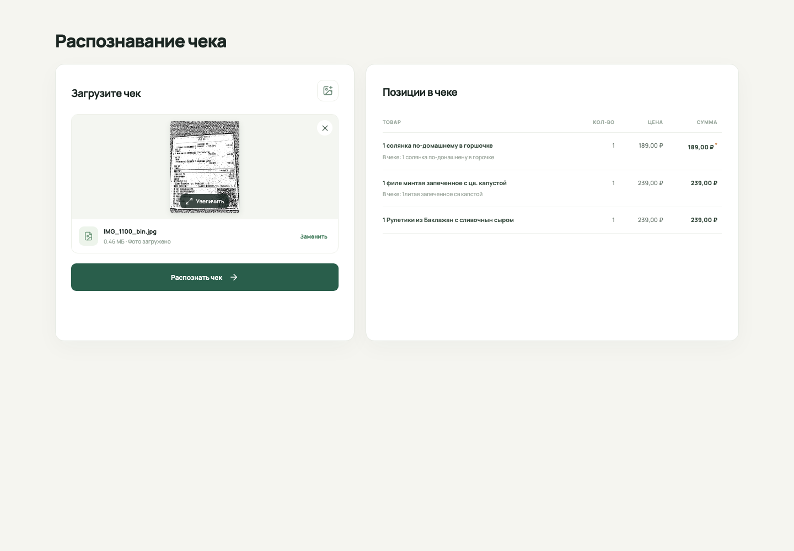

# Отчёт за 09.11–15.11.2026

**Проект:** «Receipts»  
**Команда:** 12  
**Авторы:** Мартынов Александр, Сороколетов Денис

## 1. Цель работы за период

Улучшить извлечение товаров из фотографий чеков и подготовить локальный прототип для проверки модели на отдельных изображениях.

## 2. Что было сделано

- Подключили специализированный распознаватель PP-OCRv6 для кириллицы и объединили его с детектором текста PP-OCRv5. Для выделения товарных строк обучили классификатор на OCR-результатах и разметке 544 чеков train; каталог названий также сформировали только по train.
- Улучшили группировку текстовых блоков и разбор числовых полей, в том числе обработку пробелов в цене и дозировок в названии. Неизвестные поля возвращаются как `null`, предположенные количество и сумма помечаются.
- Проверили вариант классификатора с дополнительными OCRv6-результатами для 100 обучающих чеков. Существенного улучшения он не дал, поэтому оставили более простой вариант.
- Оценили выбранный конвейер на всех 115 чеках validation. Дополнительно проверили совпадение строк с учётом похожих, но не обязательно идентичных названий.
- Подготовили локальный React-интерфейс и API для загрузки фотографии и просмотра позиций. Проверили полный запрос к модели на тестовом изображении; результат требует проверки пользователем.

## 3. Результаты проверки

| Поле | Точных совпадений | Precision | Recall | F1 |
|---|---:|---:|---:|---:|
| Название | 124 | 39,7% | 32,7% | 35,9% |
| Количество | 239 | 76,6% | 63,1% | 69,2% |
| Цена | 240 | 76,9% | 63,3% | 69,5% |
| Сумма | 247 | 79,2% | 65,2% | 71,5% |
| Полная строка | 91 | 29,2% | 24,0% | 26,3% |

На 379 размеченных позициях модель вернула 312 предсказаний. Отдельные числовые поля сравниваются независимо внутри чека и могут совпасть с данными другой позиции. Полная строка требует совпадения названия, количества, цены и суммы; все поля всех позиций совпали в 14 из 115 чеков без учёта порядка.

При сопоставлении названий с похожестью не ниже 80% F1 названий составила 65,1%, а F1 полной строки с точными числовыми полями — 48,0%. Для сравнения: ранее Donut с четырьмя полями получила F1 точных названий 3,9% и полной строки 3,3% на той же validation. Порог готовности для автоматической обработки не достигнут. Test при выборе модели не использовался. Подробная методика и ограничения разметки приведены в [отчёте по модели](../../ml/reports/item_extraction_2026-11-15.md).

Ниже — локальный интерфейс после обработки тестового чека:

## 4. Текущий статус

| Компонент | Статус |
|---|---|
| OCR и разбор товарных строк | Работают локально; качество недостаточно для автоматического сохранения без проверки |
| Локальный API и интерфейс | Подготовлены; поддерживают загрузку фото и просмотр результата |
| Проверка качества | Выполнена на validation; исходная разметка частично получена автоматически |
| Test | Не использовался для выбора модели |

Прототип позволяет получить черновик чека, но может пропускать товары, ошибаться в названиях и числах. Полученные позиции нужно проверять вручную.

## 5. План работы на следующий период

- Подготовить вручную проверенную выборку чеков для более надёжной оценки качества.
- Улучшить обработку наклонённых фотографий и связывание названия с количеством, ценой и суммой.
- Сравнить конвейер с готовыми решениями для чеков и проверить возможность получения цифрового чека по QR-коду.
- После выбора кандидата оценить его на test и продумать исправление позиций в интерфейсе.
